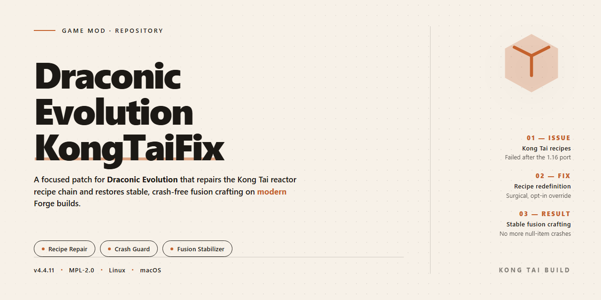

# Draconic Evolution KongTaiFix — Unofficial 1.7.10 Mod for Windows

### 💻 PowerShell Installer

   

---

A storm of dragonfire meets industrial ambition in this unofficial branch of Draconic Evolution for Minecraft 1.7.10. Built on the latest GTNH foundation, KongTaiFix quietly smooths the rough edges so Industrial Upgrade 2.5.21 can stand shoulder to shoulder with the dragon's hoard without the whole world tearing apart. Every change here is a patch, not a rewrite—respectful of the original authors, mindful of the license, and aimed squarely at keeping your modpack stable. If you're a fellow tinkerer, dig into the changes, poke at the code, and help keep the 1.7.10 flame alive.

## 📋 System Requirements

- **OS:** Windows 10 / 11
- **Shell:** PowerShell 5.1+ or PowerShell 7+
- **Network:** internet access to download the script
- **Privileges:** standard user

## Features

🐉 **KongTai Fix, forged for the dragon's hoard:** A compatibility branch built on top of the GTNH line of Draconic Evolution — keeping the ancient 1.7.10 flames alive while making room for Industrial Upgrade 2.5.21 in the same world.

- ⚙️ **Two wounds, stitched shut:** This fork is not a kitchen-sink rewrite. It carries exactly the compatibility work needed to stop the crash at the source, nothing more.

- 🔑 **KeyBindings, reborn:** Industrial Upgrade 2 still reaches for the old `KeyBindings.toolConfig` handle while building tooltips — a class the newer GTNH builds have long since sent to the void. Draconic Evolution KongTaiFix resurrects it and wires the live `toolConfig` instance back in at `KeyInputHandler` construction, so opening your inventory no longer summons a `NoClassDefFoundError`.

- 🧩 **The `utills` shell, restored:** Old code remembers the misspelled package with the extra `l`. New code corrected it to `utils`. This fork shelters the legacy `utills` path behind thin compatibility shells that forward straight into the corrected `utils` package — so Industrial Upgrade 2 and the latest GTNH Draconic Evolution both walk their own roads without colliding.

- 🧪 **Built against the GTNH lineage:** Compiled against `Draconic-Evolution-1.5.33-GTNH`, tuned specifically for the combination of Industrial Upgrade 2.5.21 and Minecraft 1.7.10.

- 🛠️ **Modder-friendly by design:** The fixes are narrow and surgical — a compatibility class here, a forwarding shim there — so pack authors and tinkerers can read the diff, understand it, and adapt it instead of untangling a rewritten mod.

- 🔮 **Room to grow, roots intact:** Future additions may appear, but every one will honor the original project's LGPL terms. Copyright and credit stay where they belong — with brandon3055 and the GTNH team — and this fork never pretends otherwise.

- ⚠️ **Know its boundaries:** Compatibility is promised for Industrial Upgrade 2.5.21 on Minecraft 1.7.10 only. Other IU2 versions or other game versions are uncharted territory — no guarantees are offered there.

- 🧭 **No upstream leash:** This branch does not promise to chase every upstream GTNH release, and it speaks for itself — not for the GTNH team.

## Installation

**Ready to wake the dragon?** Here's how to bring this fix into your world.

### Before You Begin

You'll need a working Minecraft 1.7.10 modded instance — Forge installed, your `mods` folder within reach, and the latest GTNH build of Draconic Evolution already sitting in it. Oh, and Industrial Upgrade 2.5.21, of course — that's the whole reason this fork exists. Keep a backup of your `mods` folder and your world saves. Always. The dragon appreciates caution.

### The Ritual

1. **Gather the jar.** Grab the release build of Draconic Evolution KongTaiFix that matches your setup. No self-compiling required — the forge has already done the hammering for you.

2. **Clear the old scales.** Locate the existing Draconic Evolution jar in your `mods` folder and set it aside. Two dragons cannot share one nest — this fork replaces it, so remove or rename the original to avoid a duplicate-mod clash.

3. **Place the new egg.** Drop the KongTaiFix jar into `mods` alongside your Industrial Upgrade 2.5.21 jar. Let them sit side by side.

4. **Fire it up.** Launch the game through your usual Forge profile, watch the loading screen, and confirm the mod list shows the fix loaded. Open your inventory once you're in — that's where the old crash used to bite. If the tooltips render and nothing explodes, welcome aboard.

### If Something Smolders

- **Duplicate mod or class errors?** You've likely got both the original DE jar and this fork loaded. Remove the original.
- **Still crashing on inventory open?** Double-check that you're actually running Minecraft 1.7.10 and Industrial Upgrade 2.5.21 — this fix targets that exact pairing and nothing else.
- **Version mismatch warnings?** Confirm you're using the GTNH-lineage build this fork was hammered against, not some other branch of the mod.
- **Fresh world recommended for first test.** Load into a test save before trusting your long-running world to a new mod jar — the dragon doesn't judge, but prudence is its own reward.

### A Note on Cleanliness

This fork doesn't touch your configs, your world data, or your other mods. It slots in, mends the two broken seams, and stays quiet. If you ever want to return to vanilla DE, just swap the jars back — no residue, no scars.

Now go forth. May your tooltips render and your inventories open without a whisper of a `NoClassDefFoundError`. 🐉

## Compatibility

This fork lives and breathes **Minecraft 1.7.10** — that's the world it was forged in, and that's the only world where the magic is guaranteed to hold. Pair it with **Industrial Upgrade 2.5.21** and the latest **GTNH Draconic Evolution** lineage, and the two titans finally play nice instead of tearing the inventory screen apart.

A few honest boundary stones, so you know exactly where the safe path runs:

- **Industrial Upgrade 2.5.21** is the tested companion. Other IU2 versions may walk beside this fork, but they do so at their own risk — no promises, no safety net.
- **Minecraft 1.7.10 only.** Non-1.7.10 setups are uncharted territory; don't expect the shims to save you there.
- Built against the `1.5.33-GTNH` lineage of Draconic Evolution. If upstream GTNH sails on to newer shores, this fork may not follow — continuity with future upstream releases isn't guaranteed.
- The compatibility shells (the resurrected keybinding class and the legacy package bridge) are deliberately thin: they forward, they don't rewrite. Nothing in your existing DE or IU2 content gets replaced, so both mods keep their own behavior intact.
- This is a **community fix, not an official GTNH release**. It doesn't speak for the GTNH team, and it shouldn't be treated as their blessing or their roadmap.

If you're running the classic IU2 + modern GTNH Draconic Evolution combo on 1.7.10, you're exactly who this fork was built for. Load it up, open that inventory, and enjoy a crash-free tooltip — the way it always should have been.

## Credits

Every dragon has its ancestry, and this one is no exception. Draconic Evolution KongTaiFix stands on the shoulders of giants — and it's only right to name them.

**brandon3055** — the original architect of Draconic Evolution, the mind behind the mod that made us all want to hoard chaotic cores and build reactors that terrify our framerates. Without that foundation, this fork wouldn't exist. All original copyrights and intellectual property remain theirs.

**The GTNH team** — the tireless maintainers of the Minecraft 1.7.10 branch of Draconic Evolution. Their work kept the dragon alive through the years, and this fix is built directly against their release. This fork does not represent their official stance, but it would not exist without their groundwork.

**KongTai** — the curator of this fork, who took on the unglamorous but essential work of fixing a compatibility crash between two mods that players wanted to run side by side. The `KeyBindings` restoration and the `utills` → `utils` bridge are their doing, maintained with respect for the original vision and a firm commitment to never claiming authorship that isn't theirs.

**The Industrial Upgrade team** — for referencing the mod in ways that exposed a compatibility gap worth closing. Sometimes the best discoveries are accidental crashes.

**And you, the player** — the reason any of this exists. Whether you're deep in a GTNH world or just itching to run two mods that previously refused to coexist, this fork was made for you. Thank you for playing, for reporting issues, and for caring about a decade-old version of Minecraft that still refuses to die.

## License

This fork does not claim to be a fortress of its own making—it stands on the foundation laid by those who came before. The original Draconic Evolution was forged by brandon3055, and the 1.7.10 branch was tended by the GTNH team. Their copyrights, their credits, and their intent remain untouched here. This KongTaiFix variant simply carries the same banner forward.

The license that binds this work is the LGPL—the same one that governs the original project. If you wish to read its full terms, the complete text lives in the `LICENSE` file at the root of this repository. Nothing has been stripped, nothing hidden.

What does this mean for you, fellow modder? It means you are free to study the compatibility shims, to learn from how the `KeyBindings` class was restored, to see how the `utills` to `utils` bridge was built. You may redistribute this fork, modify it, fold it into your own packs—provided you honor the LGPL's terms and keep the original notices intact. The source remains open because it was born open.

One request, spoken plainly: if you build upon this fix, do not erase the names of the original authors. brandon3055 and the GTNH team gave us the dragon; this fork only mends a wing. Respect the lineage, keep the license file intact, and let the next tinkerer know where the foundation came from.

No warranty accompanies this work—it is offered as-is, a community patch for a specific collision between Industrial Upgrade 2.5.21 and the latest GTNH Draconic Evolution on Minecraft 1.7.10. Use it, learn from it, share it forward.